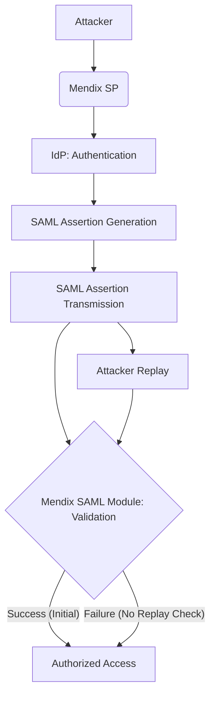

## 서론

최근 기업 보안 환경에서 '싱글 사인온(SSO)'은 단순한 편의 기능을 넘어, 사용자 인증의 핵심 방어선 역할을 수행하고 있습니다. 수많은 서비스와 애플리케이션에 걸쳐 단 하나의 유효한 인증 토큰만 검증하면 되기 때문에, SSO 시스템이 뚫리는 것은 곧 전체 IT 인프라의 문을 여는 것과 같습니다.

하지만 이 강력한 신뢰 메커니즘에도 허점은 존재합니다. 바로 **SAML Assertion Replay** 취약점입니다. 특히 Siemens Mendix SAML Module에 존재하는 CVE-2026-89209는 이 재사용 공격을 완벽하게 악용할 수 있는 대표적인 사례입니다. 이 취약점은 인증이 완료된 유효한 SAML 응답을 공격자가 캡처해두었다가, 나중에 다시 전송(Replay)함으로써 인증 절차 자체를 무력화시킵니다. 결과적으로 인증되지 않은 원격 공격자도 마치 정식 사용자인 것처럼 Mendix 애플리케이션에 무단으로 접근할 수 있게 됩니다.

본 글에서는 CVE-2026-89209의 기술적 배경을 깊이 있게 분석하고, 공격 시나리오부터 실무적인 방어 전략까지, 현장 보안 전문가의 시각으로 상세히 제시하겠습니다.

## 본론: CVE-2026-89209 심층 분석

### 1. SAML IdP-initiated Flow와 공격 메커니즘

SAML(Security Assertion Markup Language)은 웹 기반 SSO에서 가장 널리 사용되는 표준 프로토콜 중 하나입니다. 이 취약점이 발생하는 핵심 지점은 바로 **IdP-initiated Authentication Flow**입니다.

**[IdP-initiated Flow의 작동 원리]**
1. **사용자 요청:** 사용자가 서비스 제공자(Service Provider, SP, 여기서는 Mendix 애플리케이션)에 접근을 시도합니다.
2. **IdP 리디렉션:** Mendix는 사용자를 신원 제공자(Identity Provider, IdP, 예를 들어 Active Directory Federation Services)로 리디렉션합니다.
3. **인증 및 Assertion 생성:** IdP는 사용자를 인증하고, 해당 사용자의 신원 정보 및 권한이 담긴 SAML Assertion(XML 형태의 증명서)을 생성합니다.
4. **SP 접근 허용:** IdP는 이 Assertion을 Mendix로 다시 전송하고, Mendix는 이를 검증한 후 사용자에게 접근을 허용합니다.

**[공격 시나리오: Capture-Replay]** 공격자는 이 과정 중 3단계에서 생성된 유효한 SAML Assertion을 가로챕니다 (Capture). 이후, 공격자는 이 Assertion을 시간차를 두고 Mendix 애플리케이션의 Assertion 수신 엔드포인트에 재전송(Replay)합니다. 취약한 Mendix SAML Module은 이 Assertion이 '이전에 사용된 적이 없는지'에 대한 적절한 검증 로직(예: `NotOnOrAfter` 시간 검증, Assertion ID 중복 검사)을 수행하지 못하기 때문에, 시스템은 이 재사용된 Assertion을 '새롭고 유효한 인증 증명서'로 오인하고 접근을 허용하게 됩니다.

이러한 공격 흐름은 다음과 같이 시각화할 수 있습니다.



### 2. 취약점 상세 분석 및 영향도

CVE-2026-89209는 SAML Assertion의 유효성 검증 로직에 결함이 있음을 명확히 보여줍니다. 공격자는 인증 과정 자체를 거치지 않고, 단순히 '증명서'만 재활용하면 되기 때문에 공격 난이도가 매우 낮습니다.

| 제품/버전 | 호환 Mendix | 취약 버전 (≤) | CVSS v3.1 점수 | CVSS Severity | 주요 결함 |
| :--- | :--- | :--- | :--- | :--- | :--- |
| Mendix SAML (CSAFPID-0001) | Mendix 10 | V4.2.4 | 6.8 | MEDIUM | Assertion Replay 방어 미흡 |
| Mendix SAML (CSAFPID-0002) | Mendix 11 | V4.2.4 | 6.8 | MEDIUM | Assertion Replay 방어 미흡 |
| Mendix SAML (CSAFPID-0003) | Mendix 9 | V3.6.29 | 6.8 | MEDIUM | Assertion Replay 방어 미흡 |

**[기술적 평가]**
- **CVSS Vector:** `CVSS:3.1/AV:N/AC:H/PR:N/UI:R/S:U/C:H/I:H/A:N`

    *   **AV:N (Network):** 네트워크를 통해 공격 가능.     *   **AC:H (High):** 공격 복잡도가 높지 않음 (단순 재전송).     *   **PR:N (None):** 권한이 없는 상태(Unauthenticated)에서도 공격 가능.     *   **UI:R (Required):** 공격자가 사용자의 상호작용(클라이언트 측)을 유도해야 함.     *   **S:U (Unchanged):** 권한 수준을 변경하지 않음.     *   **C:H, I:H, A:N (High/High/None):** 기밀성(C)과 무결성(I)에 높은 영향을 미치며, 가용성(A)에는 직접적인 영향이 적음.

이러한 평가를 종합할 때, 이 취약점은 권한 없는 공격자가 네트워크를 통해 접근할 수 있으며, 시스템의 핵심 정보(기밀성)와 상태(무결성)를 심각하게 위협하는 **중간(MEDIUM) 이상의 위험**을 가진다고 판단할 수 있습니다.

### 3. 실무 방어 전략 및 코드 예시

CVE-2026-89209를 방어하기 위한 조치는 크게 두 가지입니다. 가장 확실한 방법은 패치(업데이트)이며, 패치가 불가능할 경우 설정 변경(Mitigation)을 통해 공격 경로를 차단해야 합니다.

#### 3.1. 구체적인 완화 조치 (Remediation)

1. **[최우선 조치] 소프트웨어 업데이트 (Vendor Fix):**     *   Mendix 10/11 호환 환경: **V4.2.4 이상**으로 업데이트     *   Mendix 9 호환 환경: **V3.6.29 이상**으로 업데이트     *   *실무 팁:* 단순 버전 체크를 넘어, 해당 버전에 포함된 패치 노트에서 Assertion Replay 방어 로직이 어떻게 구현되었는지 확인하는 것이 좋습니다.

2. **[차선책 조치] IdP-initiated SSO 비활성화 (Mitigation):**     *   Mendix SAML 설정에서 IdP-initiated SSO 기능을 강제로 비활성화합니다.     *   이 경우, 모든 사용자는 Mendix 애플리케이션에 접속한 후, 수동으로 IdP로 리디렉션되어 인증을 시작해야 합니다 (SP-initiated flow). 이 흐름은 재사용 공격에 대해 더 강력한 방어 메커니즘을 갖추고 있습니다.

#### 3.2. 개념 증명 (PoC) 코드 예시: Replay 방지 로직

실제 SAML 라이브러리 내부에서는 복잡한 XML 파싱과 연동이 필요하지만, 핵심 원리는 'Assertion ID'를 기반으로 한 중복 검사(Duplication Check)입니다. 아래는 Python을 사용한 개념적인 Replay 방지 로직입니다.

```python
from datetime import datetime, timedelta

# 이미 처리된 Assertion ID들을 저장하는 Set (메모리 캐시)
processed_assertion_ids = set()
# Assertion ID와 함께 처리 시간을 저장하는 Dictionary (TTL 관리)
assertion_timestamps = {}
# 허용되는 Assertion의 유효 시간 (예: 5분)
TTL_SECONDS = 300 

def is_assertion_valid_and_fresh(assertion_id: str, issue_time: datetime) -> bool:
    """
    Assertion ID가 중복되었는지, 그리고 TTL 내에 있는지 확인합니다.
    """
    current_time = datetime.now()
    
    # 1. 중복 검사 (Replay Check)
    if assertion_id in processed_assertion_ids:
        # 2. TTL 검사 (Assertion이 너무 오래되었는지 확인)
        if current_time - assertion_timestamps[assertion_id] < timedelta(seconds=TTL_SECONDS):
            print(f"[FAIL] Assertion ID '{assertion_id}' 재사용 감지 (Replay Attack)")
            return False
        else:
            # 오래된 Assertion ID는 재사용이 가능할 수 있음 (새로운 세션으로 간주)
            print(f"[WARN] Assertion ID '{assertion_id}' 만료됨. 재사용 허용.")
            return True

    # 3. 새 Assertion인 경우: 유효함으로 간주하고 기록
    processed_assertion_ids.add(assertion_id)
    assertion_timestamps[assertion_id] = current_time
    print(f"[SUCCESS] Assertion ID '{assertion_id}' 유효함. 인증 허용.")
    return True

# --- 테스트 시나리오 ---
# 1. 첫 번째 요청 (성공)
is_assertion_valid_and_fresh("ASSERTION_XYZ_123", datetime.now())

# 2. 즉시 재전송 (재사용 실패)
is_assertion_valid_and_fresh("ASSERTION_XYZ_123", datetime.now())

# 3. 새로운 요청 (성공)
is_assertion_valid_and_fresh("ASSERTION_ABC_456", datetime.now())
```

## 결론: 보안 전문가의 인사이트

CVE-2026-89209는 SAML 프로토콜 자체의 결함이라기보다는, 해당 모듈이 Assertion의 **신선도(Freshness)**와 **고유성(Uniqueness)**을 검증하는 데 실패했다는 점이 핵심입니다. 공격자는 복잡한 암호화나 서명 위변조 없이도, 가장 단순한 '캡처 후 재전송'만으로 목표를 달성할 수 있습니다.

**핵심 요약:** 이 취약점은 Mendix SAML Module의 IdP-initiated SSO 플로우에서 발생하는 인증 우회(Authentication Bypass) 취약점이며, 유효한 SAML Assertion을 재사용하여 인증 없이도 애플리케이션에 무단으로 접근할 수 있게 합니다.

**전문가 인사이트:** 단순히 패치를 적용하는 것(Update)만으로는 충분하지 않습니다. 보안 전문가로서 강조하고 싶은 것은 **방어 심층화(Defense-in-Depth)**입니다.

1. **패치 적용 후:** 반드시 모든 영향을 받는 버전을 최신 버전으로 업데이트하십시오.
2. **설정 강화:** IdP-initiated SSO를 사용해야 한다면, Assertion의 TTL(Time To Live)을 짧게 설정하고, Assertion ID를 저장하는 캐시 시스템을 활성화하여 중복 검사를 철저히 수행해야 합니다.
3. **모니터링:** SSO 로그에서 동일한 사용자 ID나 동일한 Assertion ID가 짧은 시간 간격으로 반복적으로 들어오는 패턴(Replay Pattern)을 탐지할 수 있도록 WAF나 SIEM 시스템에 규칙을 설정해야 합니다.

이 취약점은 SSO가 얼마나 강력한 방어 수단인지 보여주는 동시에, 그 방어 수단이 얼마나 섬세한 구현을 요구하는지를 상기시켜 줍니다. 프로덕션 환경의 모든 SAML 모듈은 이와 같은 '사소해 보이는' 로직 결함에 취약할 수 있다는 점을 항상 염두에 두어야 합니다.

--- **🔗 참고 자료 및 출처**
- **CISA Security Advisory (ICS-26-302-01):** [https://www.cisa.gov/news-events/ics-advisories/icsa-26-302-01](https://www.cisa.gov/news-events/ics-advisories/icsa-26-302-01)
- **CISA CSAF View:** [https://github.com/cisagov/CSAF/blob/develop/csaf_files/OT/white/2026/icsa-26-302-01.json](https://github.com/cisagov/CSAF/blob/develop/csaf_files/OT/white/2026/icsa-26-302-01.json)
- **CVE Details:** [https://www.cve.org/CVERecord?id=CVE-2026-89209](https://www.cve.org/CVERecord?id=CVE-2026-89209)

---

**출처**: [https://www.cisa.gov/news-events/ics-advisories/icsa-26-302-01](https://www.cisa.gov/news-events/ics-advisories/icsa-26-302-01)